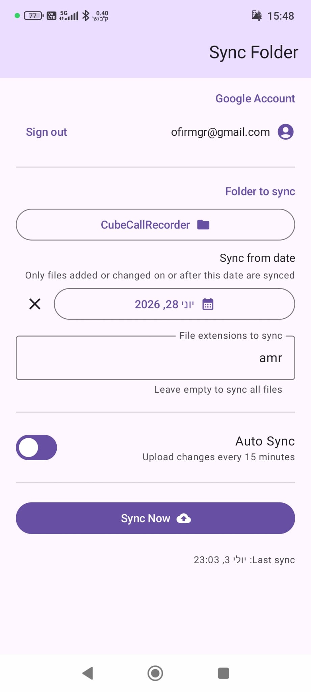

# Sync Folder

Android app that syncs a local folder and optionally all available SMS to your Google Drive (one-way upload).

## App Screenshot



- Opt-in monthly SMS backups with runtime permission and disclosure; works without a selected folder
- Picks any folder via Android's system folder picker (SAF)
- Uploads new/changed files to a matching folder in your Drive (`drive.file` scope — visible in My Drive)
- Auto-syncs every 15 minutes in the background via WorkManager
- Skips unchanged files using size + modification time

---

## Setup

### 1. Install toolchain

```bash
brew install --cask temurin@17      # JDK 17
brew install --cask android-studio  # includes Android SDK + adb
```

Open Android Studio once, let it install the SDK components, then open this project (`File → Open → sync-folder/`). Gradle sync runs automatically.

### 2. Get the Gradle wrapper JAR (command-line builds only)

Android Studio handles this automatically. For CLI builds:

```bash
./bootstrap.sh      # downloads gradle-wrapper.jar
./gradlew assembleDebug
```

### 3. Create Google Cloud credentials (automated)

```bash
brew install --cask google-cloud-sdk   # install gcloud if needed
./setup-gcloud.sh                      # creates project, enables API, opens browser for OAuth clients
```

The script automates: project creation, Drive API enablement, SHA-1 extraction, and writing `local.properties`. It opens the browser for the two OAuth client steps that Google provides no CLI API for.

Or manually — see the inline comments in `local.properties`.

### 4. Build and install

```bash
# From Android Studio: Run ▶
# Or CLI (after bootstrap.sh + setup-gcloud.sh):
./gradlew installDebug
```

---

## Usage

1. Open the app → **Sign in with Google** → grant Drive access when prompted
2. Tap **Pick a folder** → navigate to the folder you want to sync
3. Tap **Sync Now** to upload immediately
4. Toggle **Auto Sync** to upload every 15 minutes when connected

Files appear in Google Drive under a folder matching your local folder's name.

### SMS backup

SMS backup defaults to off. Updating the app preserves existing folder selection, filters,
Google account, Auto Sync preference, and folder-sync consent. SMS permission is requested
only after you enable SMS backup and accept its disclosure. The app does not change your
default SMS app, battery optimization, or Android system settings.

1. Sign in with Google, enable **Back up all SMS**, accept the disclosure, and grant SMS access.
2. Tap **Sync Now**, or enable **Auto Sync**. Each automatic sync also starts enabled
   SMS backup, normally about every 15 minutes (Android may delay it). SMS runs in
   a separate worker so it cannot block folder uploads; a backup already pending or
   running continues without being restarted.
3. In Drive, open **Sync Folder SMS / sms-<installation UUID>-<YYYY-MM>.ndjson**.

Each backup writes one UTF-8 NDJSON file per calendar month, covering every SMS
exposed by Android: inbox, sent, drafts, outbox, failed, and queued messages. The
first line carries `schemaVersion: 3`, the month, and the message count; each
following line is a single `message` object with the message body, address, original
timestamps in milliseconds since Unix epoch, type/status, thread ID, SIM subscription
ID, and other provider metadata. Messages are bucketed by your device's local time
zone. Folder date and extension filters do not apply to SMS. Messages are encoded one
at a time in memory; no temporary SMS export is stored on disk.

Only months whose contents changed are re-uploaded, so the first backup does the bulk
of the work and later runs are usually cheap. Progress is saved after each month, so
an interrupted backup resumes rather than starting over. Messages deleted from the
phone remain in Drive, and an empty phone history leaves Drive unchanged. Separate
installations get separate IDs. Files from earlier app versions — including the
one-file-per-message layout and combined snapshots — are left untouched.
MMS, attachments, RCS, and restoring messages to the phone are not supported. Android may
restrict or delay access to some messages. Revoked SMS permission produces a sync error;
allow it again in app settings or turn off SMS backup. Turning off SMS backup does not delete
existing Drive files.

Google Play distribution requires declaring restricted SMS permissions and approval for an
eligible use such as backup/restore; this feature does not itself establish eligibility. See
[Google Play SMS permissions policy](https://support.google.com/googleplay/android-developer/answer/10208820).
Do not publish this build before completing that review and updating Play data disclosures.

Verification: `./gradlew testDebugUnitTest assembleDebug lintDebug`. Real SMS access, permission
restrictions, and Drive upload must also be checked on an authorized device/account.

---

## Architecture

```
SyncScreen (Compose) ──▶ SyncViewModel ──▶ AuthManager    (Credential Manager + Identity)
                                      ├──▶ DriveClient    (OkHttp + Drive REST v3)
                                      ├──▶ SyncEngine     (DocumentFile tree walk + diff)
                                      ├──▶ SmsSyncEngine  (SMS provider → monthly NDJSON → Drive)
                                      ├──▶ SyncWorker     (auto-sync also enqueues SmsSyncWorker)
                                      ├──▶ AppDb / Room   (per-file sync state)
                                      └──▶ Prefs          (DataStore — URI, token, settings)
```
